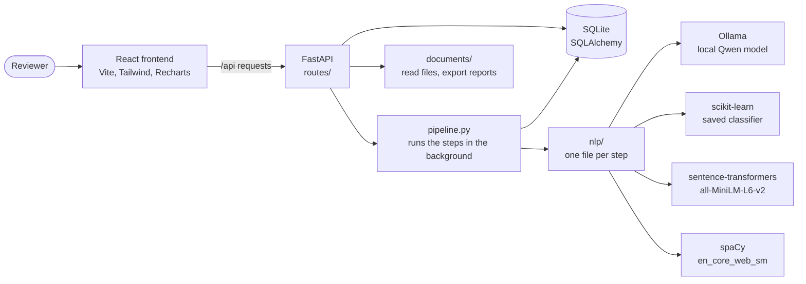
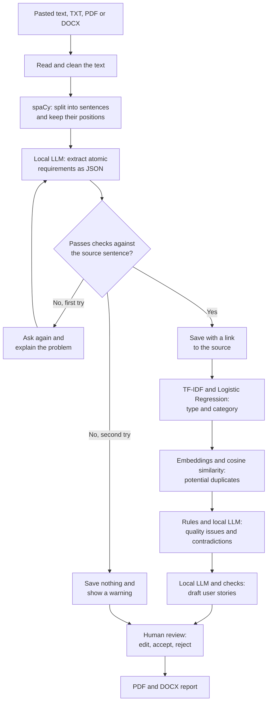
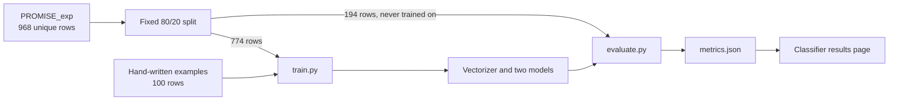

# Architecture

## System architecture

Everything runs on one computer. The frontend starts an analysis and then asks for progress every
2 seconds, so the page stays usable while the model works.

## NLP pipeline

## Classifier training

## Design decisions

| Decision | Reason |
|---|---|
| NLP files do not touch the database | Each step can be read and tested alone |
| Plain functions instead of classes | Easier to read and explain |
| Rule-based checks after the LLM | The LLM can make things up, so its answers need checking |
| No fallback when the LLM fails | A failure must be visible, so results are never faked |
| Embeddings run on the CPU | The GPU has only 4 GB, and Ollama needs it |
| Tailwind 3 rather than 4 | Version 3 is pure JavaScript, which avoids extra native binaries that Windows Smart App Control might block |
| Bind the frontend and API to this computer | There is no login, so it should not be exposed on a network |
