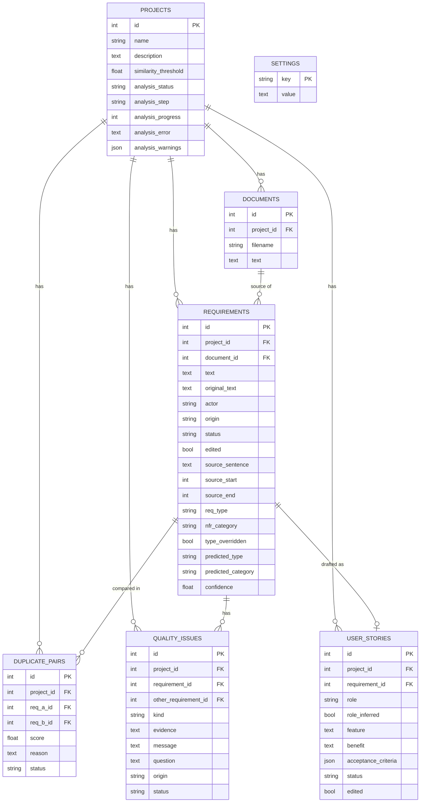

# Database schema

The database is one SQLite file, created automatically at `backend/data/app.db`. Tables are defined
in `backend/app/models.py`.

## Why some columns exist

| Column | Why |
|---|---|
| `original_text` | Keeps the AI wording after a person edits `text` |
| `source_sentence`, `source_start`, `source_end` | Link each requirement to its exact place in the source |
| `predicted_type`, `predicted_category`, `confidence` | Keep the classifier's answer, even after a person changes it |
| `type_overridden` | Stops a re-run from replacing a person's classification |
| `origin` | Shows whether an item came from AI, a rule, the LLM or a person |
| `status` | Separates reviewed content from unreviewed AI suggestions |
| `evidence` | The words in the requirement that caused a quality issue |

## Deleting

Foreign keys use `ON DELETE CASCADE`. Deleting a project removes everything inside it, and deleting
a document removes the requirements extracted from it. This is tested in `backend/tests/test_api.py`.
